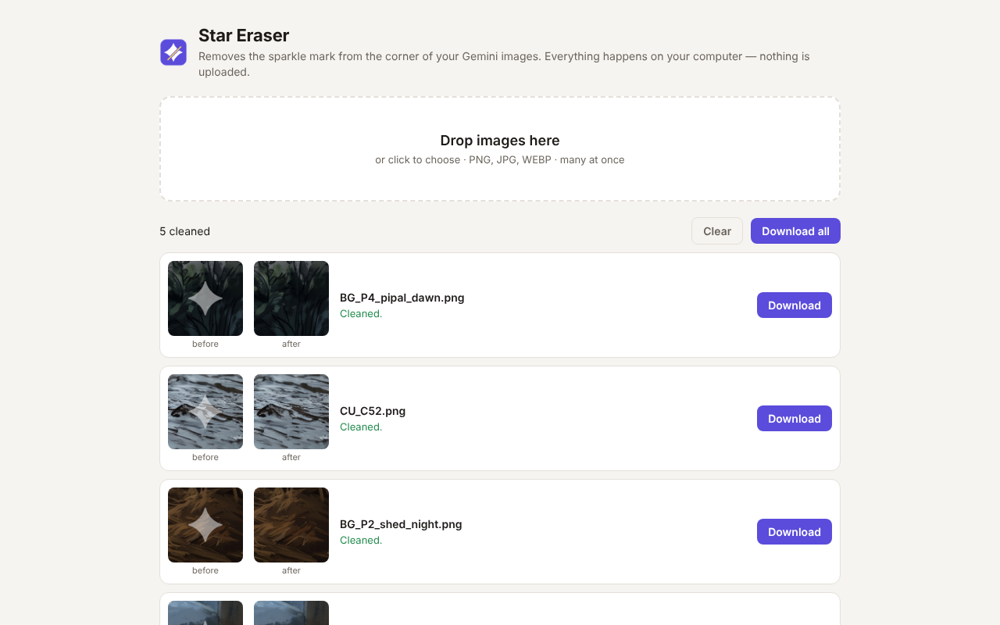

# Star Eraser for AI Images

A free Chrome extension that removes the sparkle watermark from the corner of your Gemini-generated images, entirely on your own computer.



## What it does

- Click the toolbar icon, drop in one image or many (PNG, JPG or WEBP).
- It finds the sparkle in the bottom-right corner and removes it.
- Download each clean image, or all of them at once.

## How it works

The sparkle is a semi-transparent white shape laid over the picture. Star Eraser doesn't blur or paint over it. It reverses the blend with the known transparency map of the sparkle:

```
original = (pixel − alpha × 255) ÷ (1 − alpha)
```

That recovers the real pixels underneath, so lines, textures and dark scenes stay sharp. Before keeping a result, it checks that the sparkle's outline actually disappeared, so images with no sparkle are left untouched.

- No AI, no servers, no network requests. Plain pixel maths in the browser.
- No permissions requested.
- Removes only the visible mark. Google's invisible SynthID tag stays in the image.

## Install

- **Chrome Web Store:** (link coming after review)
- **From source:** download this repo, open `chrome://extensions`, turn on Developer mode, click **Load unpacked** and pick the `extension` folder.

## Privacy

Star Eraser collects no data. Images are processed in your browser and never leave your computer. See the [privacy policy](https://sagarsuman1299.github.io/star-eraser/privacy.html).

## Support

Found an image it doesn't clean properly? [Open an issue](https://github.com/sagarsuman1299/star-eraser/issues) and attach it if you can.

## Credits and licence

Released under the MIT License (see `LICENSE`). The sparkle transparency maps in `extension/src/maps.js` are derived from [journey-ad/gemini-watermark-remover](https://github.com/journey-ad/gemini-watermark-remover), also MIT licensed; its notice is in `extension/NOTICE.txt`.

Star Eraser is an independent project and is not affiliated with or endorsed by Google.
